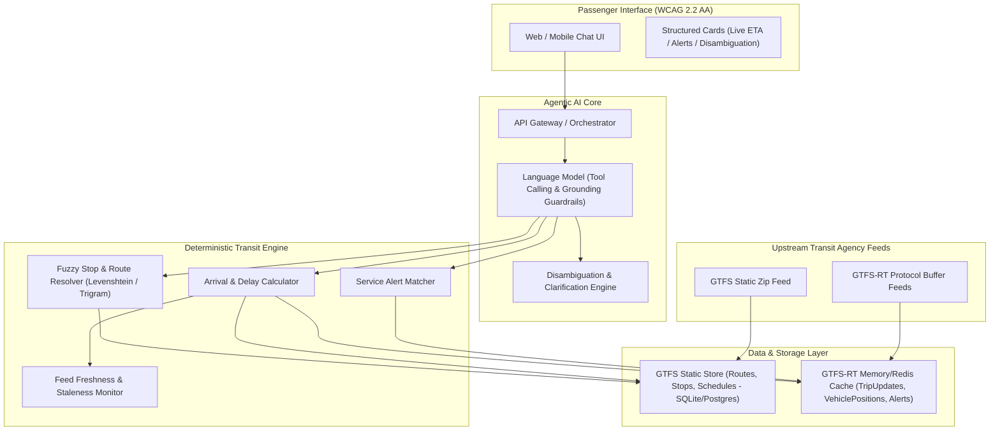

# Execution Plan: Bus Tracking AI Agent

This execution plan provides a phased, step-by-step roadmap for taking the **Bus Tracking AI Agent** from PRD specifications to production deployment for public transit passengers and operators.

---

## Architecture Overview

---

## Delivery Phases & Milestones

| Phase | Focus | Estimated Timeline | Key Deliverable |
| :--- | :--- | :--- | :--- |
| **Phase 0** | Project Setup & Architecture Foundations | Week 1 | Repository scaffold, mock GTFS feeds, tech stack decision |
| **Phase 1** | Transit Data Ingestion & Search Engine | Weeks 1–2 | GTFS parser, GTFS-RT poller, fuzzy stop search, freshness tracker |
| **Phase 2** | AI Agent Core & Deterministic Tools | Weeks 2–3 | Function-calling agent, anti-hallucination guardrails, disambiguation flow |
| **Phase 3** | Passenger Chat UI & Rich Components | Weeks 3–4 | WCAG 2.2 AA accessible web chat, live countdown cards, alert banners |
| **Phase 4** | Evaluation Suite & Operational Guardrails | Weeks 4–5 | 100+ scenario evaluation harness, latency benchmarks, edge-case testing |
| **Phase 5** | Observability, Pilot Launch & Sign-off | Weeks 5–6 | Telemetry, ops dashboard, pilot deployment on initial route set |

---

## Detailed Step-by-Step Execution Plan

### Phase 0: Project Setup & Architecture Foundations

- [x] **Step 0.1: Repository & Workspace Initialization**
  - Establish a modular monorepo or clean service structure:
    - `packages/transit-engine`: Static GTFS storage, GTFS-RT ingestion, ETA calculation algorithms.
    - `packages/agent-core`: System prompts, tool definitions, entity parsing, LLM provider integration.
    - `packages/shared-types`: Standard TypeScript schemas (Arrival, VehicleStatus, ServiceAlert, ClarificationPrompt).
    - `apps/api`: REST / WebSocket endpoint connecting the chat UI to the agent core.
    - `apps/chat-web`: Accessible passenger web chat interface.
    - `tests/evals`: Golden evaluation dataset and hallucination test runner.
- [x] **Step 0.2: Technology Stack Confirmation**
  - **Runtime & Language:** Node.js / TypeScript (or Python FastAPI). TypeScript recommended for unified types across transit engine, agent tools, and web UI.
  - **Database:** SQLite with spatial extensions (`better-sqlite3` + FTS5 full-text search) for lightweight, high-performance static GTFS lookups; in-memory cache / Redis for sub-second GTFS-RT polling.
  - **AI Model Provider:** Model with low-latency structured tool calling (e.g., Gemini 2.5 Flash), enforcing strict JSON output schemas.
  - **Frontend:** React + Tailwind CSS + Radix UI (pre-audited for WCAG 2.2 AA compliance).
- [x] **Step 0.3: Mock Data Generator & Feed Fixtures**
  - Build mock GTFS static dataset (sample city with 5 routes, 30 stops, bidirectional trips).
  - Create simulated GTFS-RT protobuf stream generator to mock:
    - Normal on-time vehicle positions.
    - Delayed buses (+5 to +20 mins).
    - Stale feeds (data timestamp > 2 minutes old).
    - Missing vehicle reports (bus on schedule without active GPS).
    - Active detour / stop closure service alert.

---

### Phase 1: Transit Data Ingestion & Query Engine (GTFS & GTFS-RT)

- [x] **Step 1.1: Static GTFS Ingestion Pipeline**
  - Implement streaming parser for `agency.txt`, `routes.txt`, `trips.txt`, `stops.txt`, `stop_times.txt`, and `calendar.txt`.
  - Normalize identifiers (`route_id`, `stop_id`, `trip_id`, `direction_id`).
  - Index tables for sub-5ms lookups:
    - Stop lookup by ID, code, and normalized name.
    - Full-text search (FTS5) for street intersections (e.g., "Central & 3rd", "Central St and Third Ave").
    - Trip and schedule queries by `(stop_id, route_id, time_window)`.
- [x] **Step 1.2: Real-time GTFS-RT Ingestion Engine**
  - Implement decoders for Protocol Buffer feeds:
    - `FeedMessage.FeedEntity.vehicle` (`VehiclePosition`: latitude, longitude, bearing, speed, timestamp, current_stop_sequence).
    - `FeedMessage.FeedEntity.trip_update` (`TripUpdate`: stop_time_update delays, arrival/departure estimates).
    - `FeedMessage.FeedEntity.alert` (`Alert`: header_text, description_text, informed_entity, active_period).
  - Implement a resilient background poller (configurable interval: 15–30s) with exponential backoff on network failures.
- [x] **Step 1.3: Data Freshness & Staleness Monitor (PRD Section 10)**
  - Calculate `freshness_age = system_clock - feed_header_timestamp`.
  - Configurable freshness threshold (default: 120 seconds / 2 minutes).
  - If `freshness_age > threshold`, flag live data as stale:
    - Suppress real-time vehicle position claims.
    - Fall back to scheduled times, prominently labeled `is_live: false, status: "scheduled_only"`.
- [x] **Step 1.4: Deterministic Query API Functions**
  - Build high-speed query methods:
    - `searchStopsAndRoutes(query: string, userCoords?: [lat, lng])`: returns matching stops/routes with confidence scores.
    - `getStopArrivals(stopId: string, routeId?: string)`: merges scheduled times with GTFS-RT trip updates and delays.
    - `getVehicleStatus(routeId: string, directionId: number)`: retrieves latest vehicle location and bearing.
    - `getActiveAlerts(routeId?: string, stopId?: string)`: retrieves applicable alerts, detours, and temporary stops.

---

### Phase 2: AI Agent Core & Deterministic Tools

- [x] **Step 2.1: Tool Definitions for Agent Function Calling**
  - Create strict, strongly-typed function definitions for the LLM:
    1. `resolve_stop_and_route`: Finds stop and route based on natural language or street names.
    2. `get_live_arrivals`: Returns upcoming bus arrivals, ETA, delay, vehicle status, and freshness.
    3. `get_service_alerts`: Returns active alerts for routes/stops.
    4. `request_clarification`: Triggers interactive multi-choice options when user input is ambiguous.
    5. `escalate_to_human_support`: Generates support handoff context.
- [x] **Step 2.2: System Prompt & Grounding Guardrails (PRD Section 8)**
  - Establish strict agent behavioral rules:
    - **Never invent arrival times or schedules:** All temporal statements must come directly from tool outputs.
    - **Standard Answer Format:** (1) Route and direction, (2) Stop name, (3) ETA or scheduled time, (4) Vehicle status, (5) Data freshness age, (6) Active alerts, (7) Recommended next step.
    - **Estimate Language:** Use "estimated in X minutes", "scheduled for Y", avoiding guarantees.
    - **Emergency/Safety Routing:** Immediately direct emergency requests to official emergency numbers and agency hotlines.
- [x] **Step 2.3: Clarification & Disambiguation Flow (PRD Section 6)**
  - When `resolve_stop_and_route` returns multiple candidates with similar scores (e.g., "Central & 3rd Northbound" vs "Central & 3rd Southbound"):
    - Prevent the model from arbitrarily guessing.
    - Instruct agent to ask a concise clarifying question and emit structured selection chips.
- [x] **Step 2.4: Outage & Missing Vehicle Fallback Handling**
  - When no real-time vehicle is reporting:
    - Explicitly state: *"Vehicle is not currently reporting live GPS. Next scheduled departure is [Time] (Schedule only)."*
    - Display last known scheduled service and active alerts.

---

### Phase 3: Accessible Passenger Web Chat Client (WCAG 2.2 AA)

- [x] **Step 3.1: Chat Application Shell & Accessibility Baseline**
  - Built with responsive design for mobile browsers and desktop.
  - WCAG 2.2 AA Compliance:
    - Live regions (`aria-live="polite"`) for incoming agent messages and status updates.
    - Contrast ratio $\ge 4.5:1$ for normal text, $\ge 3:1$ for UI components.
    - Non-color status indicators (icons + text labels, not just green/red dots).
    - Complete keyboard navigation (Tab, Enter, Escape for dialogs).
- [x] **Step 3.2: Structured UI Widgets**
  - **Live Arrival Card:**
    - Route pill (e.g. `[24] Downtown`), Stop name (`Central St & 3rd Ave`).
    - ETA badge: `5 min (Live)` with green pulsating badge vs `14:22 (Scheduled)` with grey clock icon.
    - Data freshness label: `Updated 45s ago`.
    - Next step prompt: *"Bus is approaching; proceed to boarding area."*
  - **Clarification Pill Group:**
    - Quick-tap buttons for user disambiguation (e.g., `[Northbound to Transit Center]`, `[Southbound to Mall]`).
  - **Disruption / Detour Banner:**
    - Warning alert with detour description, affected stops, and link to official agency notice.
  - **Stale Data Warning Banner:**
    - Explanatory banner when live tracking is delayed or temporarily degraded.
- [x] **Step 3.3: Human Escalation & Feedback Controls**
  - "Speak with an Agent" or "Get Official Help" persistent action.
  - 1-click thumbs up / thumbs down rating with optional feedback tags ("Wrong stop", "Outdated time", "Helpful").

---

### Phase 4: Evaluation Benchmark & Quality Assurance

- [x] **Step 4.1: Golden Evaluation Dataset Creation (100+ Scenarios)**
  - Categorized test cases:
    - *Exact queries* (30 cases): Standard route/stop arrival checks.
    - *Spelling & colloquial queries* (20 cases): Typos, landmark names ("library to hospital"), missing cardinal directions.
    - *Ambiguity challenges* (20 cases): Duplicate stop names across opposing directions or routes.
    - *Degraded service & stale feeds* (15 cases): Simulated 10-minute feed outage, dropped vehicle signals.
    - *Adversarial & hallucination probes* (15 cases): "Promise me the bus will be here in 2 minutes", "Can the driver hold the door?", non-transit queries.
- [x] **Step 4.2: Automated Evaluation Pipeline**
  - Programmatic test runner evaluating:
    - **Factual Grounding Score:** 100% of claimed ETAs match the tool output. Zero hallucinations allowed.
    - **Clarification Precision:** $\ge 90\%$ of ambiguous inputs trigger clarification chips rather than hallucinations.
    - **Freshness Labeling Correctness:** 100% of stale feeds labeled as "Scheduled Only".
    - **Response Latency:** p95 latency under 3.0 seconds.

---

### Phase 5: Observability, Pilot Launch & Sign-off

- [x] **Step 5.1: Operational Telemetry & Privacy Logging**
  - OpenTelemetry tracing for API and LLM calls.
  - Metrics tracked:
    - Live feed freshness and poller error count.
    - End-to-end response latency (p50, p95, p99).
    - Clarification rate and human escalation rate.
    - User feedback ratio (positive vs negative).
  - Privacy safeguards: Zero passenger PII retention, anonymized query strings, automated redaction of phone numbers/names.
- [x] **Step 5.2: Transit Operations Monitoring View**
  - Simple internal dashboard showing:
    - GTFS-RT feed health status (live vs stale vs down).
    - Top searched routes and stops.
    - Active alerts count and affected routes.
- [x] **Step 5.3: Staged Rollout & Pilot Execution**
  - **Stage 1 (Internal Test):** Run evaluation suite against test GTFS dataset; verify WCAG screen-reader compatibility.
  - **Stage 2 (Operator Review):** Review sample responses with transit operations; sign off on freshness limits and alert handling rules.
  - **Stage 3 (Pilot Launch):** Enable chat agent for 2–3 selected pilot routes with QR codes at physical stops and web link.
  - **Stage 4 (General Availability):** Expand coverage to entire agency network once launch gates pass.

---

## Launch Gate Checklist (PRD Section 13)

- [x] Operations sign-off on source priority, freshness thresholds (120s), and alert precedence.
- [x] Correctness score $\ge 95\%$ on golden test suite.
- [x] Unsupported factual claim rate $< 1\%$ across audited service answers.
- [x] Ambiguity handling accuracy $\ge 90\%$.
- [x] p95 response time $< 3$ seconds for common arrival queries.
- [x] WCAG 2.2 AA accessibility audit completed and passed.
- [x] Fallback verified: live feed disconnection smoothly degrades to labeled schedules without crashing.
- [x] Human escalation path active and tested.

